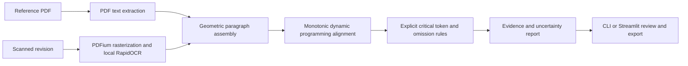

# Leaflet Compare

Compare a reference text PDF with a scanned revision using local OCR, deterministic paragraph alignment and explicit critical-change rules. Inspect the extracted text beside highlighted source evidence, record a review decision, and export JSON or a self-contained HTML review report.

**Independent portfolio project using visibly synthetic fictional decorative materials. No affiliation with Schlafender Hase, TVT compatibility, clinical suitability, or GxP/medical-device compliance is claimed.** No real patient data, medication instructions, or proprietary documents are included.

Start with the [five-minute review walkthrough](docs/WALKTHROUGH.md), [example report](examples/dev-quantity/review.html) (download and open locally), or [claim-to-evidence map](docs/APPLICATION_EVIDENCE.md).

## Run locally

Python **3.12** is required by this pinned OCR release. Windows PowerShell:

```powershell
cd D:\Projects\leaflet-compare
py -3.12 -m venv .venv
.\.venv\Scripts\Activate.ps1
python -m pip install -r requirements-lock.txt
python -m pip install -e . --no-deps
python -m tools.generate
python -m pytest -m "not ocr"
python -m pytest -m ocr
python -m leaflet_compare.cli data/dev-quantity/reference.pdf data/dev-quantity/scan.pdf --output runs/example
python -m tools.evaluate --split dev --output runs/dev-reproduced
python -m tools.evaluate --split heldout --output runs/heldout-reproduced
python -m streamlit run app.py
```

If `py` is unavailable, use your Python 3.12 executable. Activation is optional: invoke `.venv\Scripts\python.exe` directly. On Linux/macOS use `python3.12 -m venv .venv` and `source .venv/bin/activate` instead. The UI binds to localhost. Select the built-in synthetic example or upload two PDFs. Review statuses and notes are stored in the current UI session and included in downloads; export before closing. Imports of previous review sessions and multi-reviewer audit trails are outside this version.

Dependency installation needs network access; OCR inference, tests and comparison run locally with the model files bundled in RapidOCR. No LLM or OCR service is used. Streamlit telemetry is disabled. Temporary upload files are removed after each run; extracted text and input bytes remain in session memory until the session ends. Exported reports contain extracted document content and source crops. Do not put sensitive exports in a public repository.

CLI exit code 0 means comparison completed, **not** that documents match or a change was verified. Code 2 means extraction issues require attention. Both JSON and HTML are still written. File read/write errors fail normally. Inputs are limited to 12 pages; the UI also limits uploads to 20 MB each. This local tool is not hardened for hostile PDFs or very large page dimensions.

## Measured results

First held-out run on 2026-11-06, using the frozen protocol and a different template/text from development:

|Measure|Development (12 cases)|Held-out (12 cases)|
|---|---:|---:|
|Critical true positives / labelled changes|7 / 9|8 / 9|
|Critical false positives|8|1|
|Critical precision|7 / 15 = 46.7%|8 / 9 = 88.9%|
|Critical recall|7 / 9 = 77.8%|8 / 9 = 88.9%|
|Critical changes missed|2|1|
|All findings on unchanged/layout controls|6 across 2 cases|6 across 2 cases|
|Control cases with any alarm|2 / 2|2 / 2|
|Cases routed to review|12 / 12|12 / 12|
|Critical review coverage|9 / 9|9 / 9|
|OCR character errors / truth characters|304 / 5,463 (5.56%)|247 / 5,530 (4.47%)|
|OCR word errors / truth words|324 / 839 (38.62%)|318 / 844 (37.68%)|

**All cases require review.** Coverage is not detection performance: 100% review coverage does not repair missed detections. The controls produce three wording alarms each because OCR merges spaces in the repeated heading/footer. High OCR recognition scores do not prevent those errors. Whitespace-only differences remain visible as wording findings rather than being silently discarded or classified as lost critical tokens. Word error rates are particularly sensitive to these merged spaces.

Rotation causes the held-out critical miss and one false critical finding. Development rotation and obscuration also fail. The clean critical changes are detected in this narrow dataset; these small denominators do not support real-world reliability or safety claims. The fixed obscuration region affects different text under the two templates, and leaves the held-out quantity readable. It is not a validated degradation model.

See [held-out category/scan-condition results and failures](evaluation/results/heldout/RESULTS.md), [development results](evaluation/results/dev/RESULTS.md), [full machine-readable metrics](evaluation/results/heldout/metrics.json), [matching protocol](evaluation/PROTOCOL.md), and [run history](evaluation/RUN_LOG.md). After that first run, an independent rule audit fixed percentage-unit deletion and added a regression test (rules v1.1). Original v1.0 results are preserved; the [v1.1 run](evaluation/results/heldout-v1.1-reused/RESULTS.md) is an explicitly reused-set confirmation with unchanged counts. That set is inspected; future tuning requires a new untouched set or explicit reuse disclosure. Repeated runs reproduce a measurement, not a new holdout.

## Architecture and decisions



- `extraction.py`: PDF text through pdfplumber; revision always rasterized at 180 DPI, then RapidOCR 1.4.4 / ONNX Runtime CPU. The revision text layer is never used. Adjacent lines are grouped geometrically. Paragraph scores retain the minimum line recognition score, not a calibrated probability. Empty, sparse, low-score, corrupt, over-limit and failed-page extractions produce explicit issues.
- `alignment.py`: monotonic paragraph sequence alignment with gaps and a minimum substitution similarity. Layout wrapping is handled by paragraph assembly. Reordered paragraphs and arbitrary multi-column reading order are unsupported.
- `text.py` / `comparison.py`: normalization changes case and whitespace only. It preserves digits, signs, decimal punctuation, units and negation. Explicit rules identify quantity/unit token changes, negation token changes, warning changes/omissions, missing paragraphs and other wording changes. Units recognized: mg, mcg, kg, ml, mm, cm, g, l, %, degrees. This is lexical detection, not semantic equivalence or validation of quantities. Complex exponents and locale-specific numeric conventions need more work.
- `model.py`: documents, paragraph spans and findings with IDs, SHA-256 hashes, original-page boxes, extraction methods, scores, review statuses and reviewer notes. Boxes are paragraph envelopes in PDF points from the top-left; rotation evidence uses original page coordinates. An absent side has no invented box.
- `reporting.py`: escaped readable HTML, embedded highlighted source crops, and full JSON extraction provenance. HTML exports contain no JavaScript. JSON is the portable review record, without a formal signed audit trail.
- `app.py` / `cli.py`: thin entry points. The comparison pipeline has no manifest argument and never imports dataset/evaluation modules.
- `tools/`: synthetic authoring and a separate evaluation harness. Each case includes digital reference, digital revision, image-only revision PDF and known revision text. Rasterization and degradation are deterministic; PDF generation fixes metadata. Manifests are SHA-256 checked before generation/evaluation.

The deterministic rules make findings explainable and testable. An LLM would add privacy, cost and semantic-evaluation requirements without solving the demonstrated OCR evidence problem, so none is included. RapidOCR is used for local learned text detection/recognition; comparison remains explicit.

## Verification and boundaries

19 tests passed locally, including 18 offline tests and one separately marked OCR integration test. Tests cover punctuation/number/negation preservation, unit changes, line wrapping, omission alignment, corrupt/empty/low-score extraction, provenance integrity, report escaping, one-to-one evaluation matching, edit distance, UI startup and an image-only scanned-PDF end-to-end quantity change. A separate manual Streamlit AppTest exercise checks the built-in example and review-status persistence. GitHub Actions runs offline tests; OCR integration is deliberately separate.

This is an English prose comparison system with a synthetic two-template evaluation, not a production document verifier. Geometry heuristics can merge or split paragraphs. OCR can confidently miss text; extraction issues are best-effort signals and cannot prove completeness. A partly unreadable page can still produce apparent deletions. Source inspection remains essential even when no finding is raised. Only explicit warning keywords are recognized. There is no multilingual semantic equivalence, translation validation, handwriting, tables, barcodes, clinical advice, regulatory certification, authentication, cloud service or distributed infrastructure.

Source code is MIT licensed. Dependencies and OCR model artifacts retain their own licenses; see [third-party notes](docs/THIRD_PARTY.md). Model binaries and the virtual environment are installed dependencies, not vendored into this repository.
