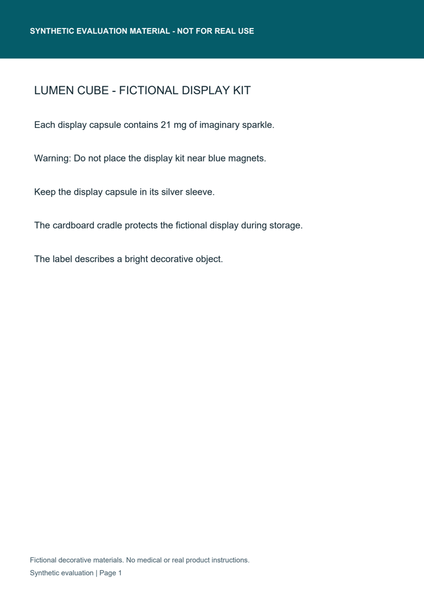

# Five-minute review walkthrough

No code execution is needed for this review. GitHub displays the JSON and Markdown; download the HTML reports and open them locally for embedded source crops.

## 1. Inspect the synthetic material

The visible header identifies synthetic evaluation material. The example changes imaginary sparkle from **12 mg to 21 mg** in a fictional decorative display capsule. It is not a real product or medication instruction.

## 2. Inspect a detected quantity change

Open [the complete review report](../examples/dev-quantity/review.html) or [its JSON](../examples/dev-quantity/report.json). Finding **F003** is `quantity_unit`, with reference `12 mg` and revision `21 mg`. Both excerpts link to page 1 and paragraph bounding boxes; the HTML embeds highlighted crops from both actual PDFs. The full extracted documents and SHA-256 fingerprints are in JSON.

The other three findings in this pair are OCR space-merging artifacts in headings/footer. Their presence is part of the measured review workload, not hidden by the example. Every finding starts `unreviewed`. In Streamlit, inspect the source crop, then choose `verified_change`, `ocr_artifact` or `unresolved` and add a note. JSON and HTML downloads include that current state. A high recognition score alone is insufficient evidence of a true authoring change.

## 3. Inspect failures

- [Held-out rotated case](../examples/heldout-rotation/review.html): the intended negation edit is missed under exact category/paragraph matching; one false critical finding is recorded. Inspect [JSON](../examples/heldout-rotation/report.json) and the [failure breakdown](../evaluation/results/heldout/RESULTS.md).
- [Development obscured case](../examples/dev-ambiguous/review.html): a white region conceals quantity text. The system presents uncertain differences and requires review, but does not correctly detect the intended quantity edit. Its review coverage is not a true positive.

## 4. Assess the evidence

The [frozen protocol](../evaluation/PROTOCOL.md) defines one-to-one matching before measurement. The [held-out metrics](../evaluation/results/heldout/metrics.json) show 8 true critical detections, 1 false critical detection and 1 missed critical change. Both controls have wording alarms; all cases require review. Input, manifest, source and environment fingerprints accompany the measurements. [Run history](../evaluation/RUN_LOG.md) discloses development tuning and holdout inspection.

For code review, follow the [application-evidence map](APPLICATION_EVIDENCE.md). To reproduce, use the README command sequence. The tiny synthetic dataset establishes the behavior shown here, not real-world safety.
